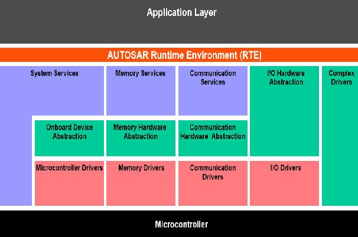

## RTE



RTE(Run-Time Environment)는 SWC와 BSW 사이, 그리고 SWC와 SWC 사이의 **모든 통신을 중개하는 계층**이다. SWC는 상대가 같은 ECU에 있는지, CAN 너머 다른 ECU에 있는지 모른 채 `Rte_Write()` / `Rte_Read()` / `Rte_Call()`만 호출한다.

### AUTOSAR 개발 순서

#### Configure System

시스템 구성 단계에서 설계한 어플리케이션은 다음의 과정을 통해 제어기 내에서 동작한다.

1. **어플리케이션 개발**
   - 서로 연결된 SW-C들의 집합을 통해 설계
2. **VFB (Virtual Functional Bus)**
   - 연결된 컴포넌트들이 교류하는 가상의 통신 구조
   - 이 단계에서는 ECU나 버스를 고려하지 않고, "어떤 컴포넌트가 어떤 데이터를 주고받는가"만 정의한다.
3. **제어기 할당**
   - 컴포넌트를 특정 제어기(ECU)에 배치
   - 같은 ECU에 배치된 컴포넌트 사이의 연결은 **ECU 내부 통신**(RTE 버퍼)이 되고, 다른 ECU로 나뉜 연결은 **ECU 간 통신**(COM → CAN/Ethernet)이 된다.
4. **Run-Time Environment**
   - 제어기 할당을 통해 분류된 연결에 대해 컴포넌트 간 또는 BSW 간의 구체적인(실제) 인터페이스
   - VFB 수준에서 설계한 컴포넌트 및 관계를 제어기 상에서도 동작할 수 있도록 코드화 (**VFB의 구현**)

### Component 종류

| 종류 | 설명 |
| --- | --- |
| Application SWC | 하드웨어와 무관한 제어 로직 |
| Sensor/Actuator SWC | 센서·액추에이터 값을 물리량으로 변환, IoHwAb와 연결 |
| Composition | 여러 SWC를 묶은 계층 구조 |
| Service SWC / Service | BSW 서비스(NvM, Dem, Dcm 등)를 표준 인터페이스로 제공 |
| ECU Abstraction SWC | ECU의 입출력(IoHwAb)을 SWC 형태로 제공 |
| Complex Device Driver SWC | 표준에 없는 하드웨어를 직접 제어 |
| Parameter / NvBlock SWC | 보정 파라미터, 비휘발성 데이터 제공 |

#### Software Component Description

소프트웨어 컴포넌트를 구성하고 설계한 정보를 담고 있는 문서 (ARXML)

##### 개발 단계

1. **VFB level : 최상위 단계**
   가장 추상화되어 있는 단계로 컴포넌트 및 컴포넌트 간 연결을 기술하며 컴포넌트 통신 속성 및 서로의 관계를 표현한다.
   1. **Component**
      VFB 수준에서 시스템을 구성할 때 사용되는 중심 구성 요소로 **Port**를 가진다. Port는 정확히 하나의 컴포넌트에 속하며 다른 컴포넌트와 상호작용하는 지점이다.
   2. **Composition**
      다른 컴포넌트를 포함하는 컴포넌트로, 컴포넌트는 composition 내에서 component-prototype으로 존재한다.
   3. **Port**
      컴포넌트 간 상호작용 지점. 방향에 따라 나뉜다.
      - **P-Port (Provided)** : 데이터/서비스를 제공
      - **R-Port (Required)** : 데이터/서비스를 요구
      - **PR-Port** : 둘 다
   4. **Interface**
      포트가 제공하거나 요구하는 타입 정의
      - **Sender-Receiver** : 데이터 전달 (1:N, N:1)
      - **Client-Server** : 함수 호출과 결과 반환 (N:1)
      - Mode-Switch, Parameter, NvData, Trigger 인터페이스 등
   5. **Assembly/Delegation Connector**
      - Assembly : 같은 Composition 안의 컴포넌트 포트끼리 연결
      - Delegation : Composition 내부 컴포넌트의 포트를 Composition 바깥 포트로 위임
2. **RTE level : 중간 단계**
   컴포넌트의 행동(Internal Behavior)을 기술한다. VFB에서 ECU에 연결할 준비를 이 단계에서 한다.
   1. **Runnable**
      컴포넌트 실제 구현을 구성하는 가장 작은 단위. RTE로 시작되는 Instruction sequence이다. 하나의 컴포넌트에 여러 Runnable 포함이 가능하다. 즉, 프로그램을 실행하는 코드의 단위이다.
   2. **Event**
      Runnable이 특정 방식으로 실행될 수 있도록 Event를 지정한다. 주요 Event는 다음과 같다.
      - `TimingEvent` : 주기 실행 (예: 10ms)
      - `DataReceivedEvent` : 데이터 수신 시 실행
      - `OperationInvokedEvent` : Client가 Server를 호출할 때 실행
      - `InitEvent` : 초기화 시 1회 실행
      - `ModeSwitchEvent` : 모드 전환 시 실행
   3. **Access Point**
      Runnable에서 RTE가 제공하는 API를 사용하는데, 이 API를 Access Point를 통해 지정한다. (어떤 Runnable이 어떤 포트를 읽고 쓰는지 선언해야 해당 `Rte_` API가 생성된다.)
3. **Implementation level : 최하위 단계**
   Internal Behavior를 구현한다. 즉 RTE level에서의 Runnable에 해당하는 코드를 작성한다.

```c
/* 10ms TimingEvent로 실행되는 Runnable 예시 (포트/요소 이름은 예시) */
void Re_DialSensor(void)
{
    uint16 raw;
    Rte_Read_RpDialRaw_Value(&raw);          /* R-Port로 값 읽기 */
    Rte_Write_PpDialLevel_Level(raw >> 8);   /* P-Port로 값 제공 */
}
```

#### ECU Configuration Description

- **ECU Configuration Description**
  - 제어기에 대한 설정 정보를 담고 있는 문서
- **RteSwComponentInstance**
  - 제어기에 할당된 컴포넌트에 대해 제어기 관련 설정을 하기 위해 해당 컴포넌트를 명시화
- **RteEventToTaskMapping**
  - Runnable을 실행하는 event에 대해 RTE가 실제 코드 구현을 할 수 있도록 자원을 할당한다. (OsTask, OsAlarm)
  - 예 : 10ms `TimingEvent`를 가진 Runnable들을 `OsTask_10ms`에 순서대로 매핑하면, RTE가 그 태스크 본문에서 Runnable들을 호출하는 코드를 생성한다.
