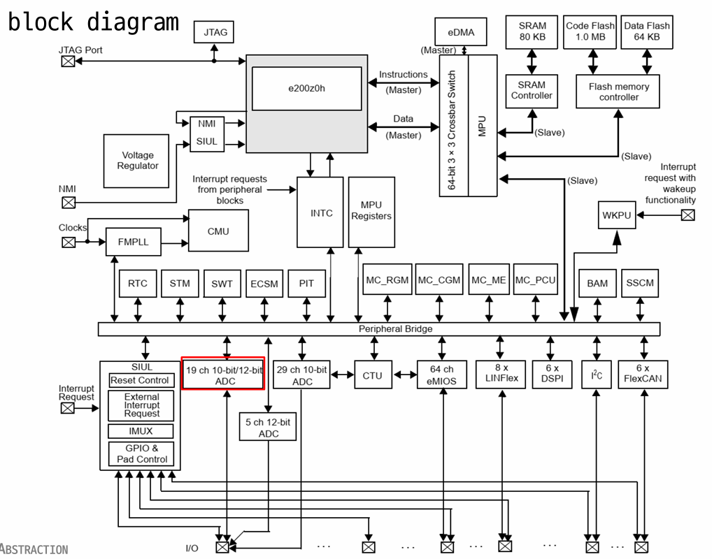
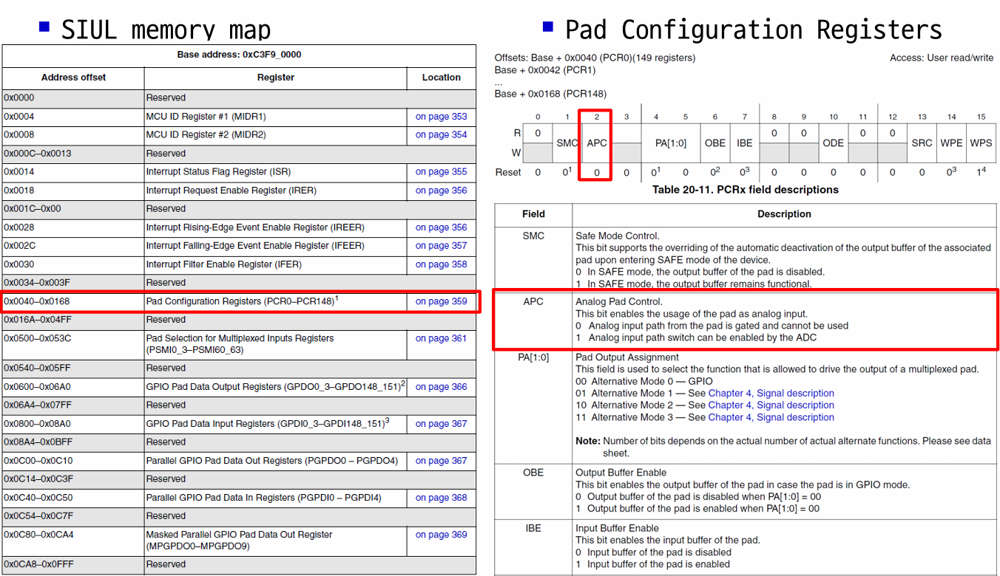

## AUTOSAR Classic 계층 구조 다시 보기

```text
┌──────────────────────────────────────────────────────────────┐
│            Application Layer (SW-C)                          │
├──────────────────────────────────────────────────────────────┤
│            RTE (Runtime Environment)                         │
├───────────────┬────────────────┬──────────────┬──────────────┤
│ Services      │ Communication  │ I/O HW       │              │
│ (OS, NvM,     │ Services       │ Abstraction  │   Complex    │
│  Dcm, EcuM)   │ (Com, PduR)    │ (IoHwAb)     │   Drivers    │
├───────────────┼────────────────┤              │   (CDD)      │
│ Onboard Dev.  │ Comm. HW Abs.  │              │              │
│ / Memory Abs. │ (CanIf)        │              │              │
├───────────────┴────────────────┴──────────────┤              │
│ MCAL (Microcontroller Abstraction Layer)      │              │
│  Dio, Port, Adc, Pwm, Can, Fls, Spi ...       │              │
└───────────────────────────────────────────────┴──────────────┘
                      Microcontroller
```

- I/O Hardware abstraction에는 autosar에서 정해놓지 않은 것을 확인할 수 있는데 OEM마다 사용하는 hardware가 다르기 때문에 OEM이 직접 구현해서 사용하도록 한다.
- Complex driver에서는 autosar에서 정의해놓지 않은 driver를 사용하고자 할 때 사용한다. 내가 원하는 것 뭐든지 구현이 가능하다.
  - 대신 표준 계층을 건너뛰고 하드웨어에 직접 접근하므로, 재사용성과 이식성은 개발자가 책임져야 한다. 아주 빠른 타이밍이 필요한 센서 처리(예: 엔진 크랭크 신호)나 표준에 없는 장치에 주로 쓴다.

참고로 찾아 둔 사이트

- [MCAL Layer in AUTOSAR](https://yoginsavani.com/mcal-layer-in-autosar/)
- [Embedded System Interview Questions](https://yoginsavani.com/embedded-system-interview-question/)
- [AUTOSAR Adaptive Platform](https://www.autosar.org/standards/adaptive-platform)

## AUTOSAR IO Hardware Abstraction (IoHwAb)

### AUTOSAR SW-Cs (software component)

- **Application SW-C** : ECU와 위치가 독립적이다. 어느 ECU에 배치해도 RTE만 맞으면 동작한다.
- **Sensor-Actuator SW-C** : 특정 센서/액추에이터에 의존한다. (예: 포텐셔미터 값을 각도로 바꾸는 로직)
  - 하드웨어와 연결 가능한 컴포넌트이지만, **ECU 하드웨어(핀, ADC 채널)에는 직접 의존하지 않고 IoHwAb를 통해** 접근한다.
  - 성능/효율성 때문에 센서가 물리적으로 연결된 ECU에 배치된다.

### IoHwAb가 하는 일

SWC는 "다이얼 값", "열선 출력" 같은 **의미 있는 신호**를 원하고, MCAL은 "ADC 채널 3", "PWM 채널 7" 같은 **MCU 자원**만 안다. IoHwAb가 그 사이를 이어 준다.

| 계층 | 보는 것 | 예시 |
| --- | --- | --- |
| SWC | 물리적 의미 | `IoHwAb_Get_DialPosition()` |
| IoHwAb | ECU 보드 배선 | 포텐셔미터는 PB4 핀의 ADC 채널에 연결 |
| MCAL | MCU 레지스터 | `Adc_ReadGroup()`, `Pwm_SetDutyCycle()` |

[Heating Project](/2025-03-19-autosar4_HeatingProject/)에서 `If_AnaInDir`, `If_Pwm`, `If_DigDir` 인터페이스가 바로 IoHwAb로 연결되는 부분이다. 보드를 바꾸면 IoHwAb 구현만 바꾸고 SWC는 그대로 쓴다.

## MCAL과 Port Driver



포인터를 이용해서 Memory Mapped IO를 사용하도록 설계할 수 있다. (MPC5606B 블록 다이어그램)



이렇게 매뉴얼로 찾아서 직접 하나씩 접근하다 보면 실수가 많아진다. 레지스터 주소, 비트 위치를 손으로 계산하면 MCU가 바뀔 때마다 다시 해야 한다. 이를 쉽게 해 놓은 게 **PORT DRIVER**다.

**Configuration of Ports and Port Pin Properties**

- Configuration and initialization of different functionality for each port and port pin
- Configuration of the port (whole port or single port pin) is MCU and ECU dependent

### Port Driver와 Dio Driver

| 모듈 | 역할 | 주요 API |
| --- | --- | --- |
| **Port** | 핀의 **초기 설정** (방향, 기능 선택(GPIO/ADC/PWM 등), 풀업/풀다운, 구동 세기) | `Port_Init()`, `Port_SetPinDirection()` |
| **Dio** | 설정이 끝난 디지털 핀의 **읽기/쓰기** | `Dio_ReadChannel()`, `Dio_WriteChannel()`, `Dio_FlipChannel()` |

- 핀 설정은 설정 도구에서 표로 작성하고, 생성된 설정 구조체를 `Port_Init(&PortConfig)`으로 넘긴다.
- 애플리케이션 코드에는 `Dio_WriteChannel(DioConf_LED1, STD_HIGH);`처럼 **이름**만 남고 레지스터 주소는 사라진다.

직접 레지스터를 다뤄 본 경험([TC275 GPIO 실습](/2025-02-11-MCU-프로그래밍/))이 있으니, MCAL이 내부에서 무엇을 대신해 주는지가 더 잘 보였다.
