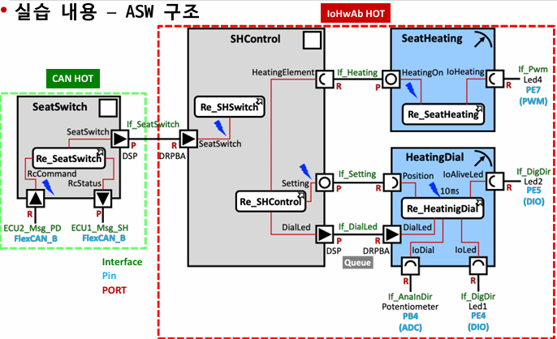

[Autosar (5)](/2025-03-19-autosar5_communication_layers/)에서 정리한 Communication Stack을 실습 프로젝트에 대입해서, **신호 하나가 SWC에서 CAN 버스까지 내려가는 경로**를 모듈 단위로 따라가 본다.

## 실습 구성

[Heating Project](/2025-03-19-autosar4_HeatingProject/)의 `SeatSwitch` SWC는 CAN으로 다른 ECU와 통신한다.

- **수신** : `ECU2_Msg_PD` 메시지의 신호 → `RcCommand` 포트 (시트 열선 명령)
- **송신** : `RcStatus` 포트 → `ECU1_Msg_SH` 메시지의 신호 (현재 상태 보고)
- 물리 채널 : FlexCAN_B



## 송신 경로 (Tx)

```text
SWC (Runnable)
  │ Rte_Write_RcStatus_<Element>(value)
  ▼
RTE ──── 신호 값을 Com으로 전달
  │ Com_SendSignal(ComSignalId, &value)
  ▼
COM ──── 신호를 I-PDU 버퍼의 정해진 비트 위치에 패킹
  │ (전송 모드: 주기/이벤트) Com_MainFunctionTx
  │ PduR_ComTransmit(PduId, &PduInfo)
  ▼
PduR ─── 라우팅 테이블에 따라 하위 모듈 선택
  │ CanIf_Transmit(CanIfTxPduId, &PduInfo)
  ▼
CanIf ── L-PDU를 하드웨어 송신 객체(HTH)와 CAN ID에 매핑
  │ Can_Write(Hth, &CanPdu)
  ▼
Can Driver ── CAN Controller 메일박스에 기록 → 버스로 전송
```

전송이 끝나면 반대 방향으로 확인 콜백이 올라온다.
`Can → CanIf_TxConfirmation → PduR_CanIfTxConfirmation → Com_TxConfirmation`

## 수신 경로 (Rx)

```text
Can Driver ── 수신 인터럽트 또는 Can_MainFunction_Read
  │ CanIf_RxIndication(Mailbox, &PduInfo)
  ▼
CanIf ── CAN ID로 수신 PDU 식별 (필터링, DLC 검사)
  │ PduR_CanIfRxIndication(PduId, &PduInfo)
  ▼
PduR ─── 목적지(COM) 라우팅
  │ Com_RxIndication(PduId, &PduInfo)
  ▼
COM ──── I-PDU에서 신호 언패킹, 타임아웃 감시
  │ 수신 알림 → RTE
  ▼
RTE ──── 버퍼 갱신, 필요 시 DataReceivedEvent로 Runnable 실행
  │ Rte_Read_RcCommand_<Element>(&value)
  ▼
SWC
```

## 계층별로 아는 정보가 다르다

**계층마다 알고 있는 정보의 범위가 명확히 나뉜다**.

| 계층 | 다루는 단위 | 알고 있는 것 | 모르는 것 |
| --- | --- | --- | --- |
| SWC / RTE | Signal (값) | 데이터의 의미 | 어떤 버스로 가는지 |
| COM | Signal ↔ I-PDU | 신호의 비트 위치, 전송 모드 | 컨트롤러, CAN ID |
| PduR | I-PDU | 어느 모듈로 보낼지 | 프레임 형식 |
| CanIf | L-PDU | CAN ID, 어떤 HTH/HRH | 신호의 의미 |
| Can Driver | 프레임 | 레지스터, 메일박스 | 상위 데이터의 의미 |

그래서 CAN 대신 Ethernet으로 바꾸더라도 SWC 코드는 그대로 두고, PduR 아래의 설정(SoAd, TcpIp 등)만 바꾸면 된다. 이것이 AUTOSAR가 말하는 **하드웨어 독립성과 재사용성**의 실체다.

## 설정해야 하는 주요 항목

코드는 대부분 생성되고, 개발자가 하는 일은 **설정(ARXML)을 정확히 맞추는 것**이다.

| 모듈 | 주요 설정 |
| --- | --- |
| COM | ComSignal(비트 위치, 길이, 엔디안, 초기값), ComIPdu(방향, 전송 모드, 주기) |
| PduR | PduRRoutingPath (Src PDU → Dest PDU) |
| CanIf | CanIfTxPduCfg / CanIfRxPduCfg (CAN ID, DLC, 연결할 HTH/HRH) |
| Can | CanController(보오레이트, 비트 타이밍), CanHardwareObject(메일박스, 필터) |

DBC에 정의된 메시지/신호 정보가 이 설정들의 출발점이 된다.

## 자주 실수하는 부분

- **바이트 순서(Intel/Motorola)** 를 DBC와 COM 설정에서 다르게 잡으면, 값이 이상하게 해석된다.
- **PDU ID 매핑**이 계층 사이에서 어긋나면 컴파일은 되지만 데이터가 전달되지 않는다.
- 수신 신호의 **타임아웃** 설정이 없으면 상대 ECU가 죽어도 마지막 값을 계속 쓰게 된다.
