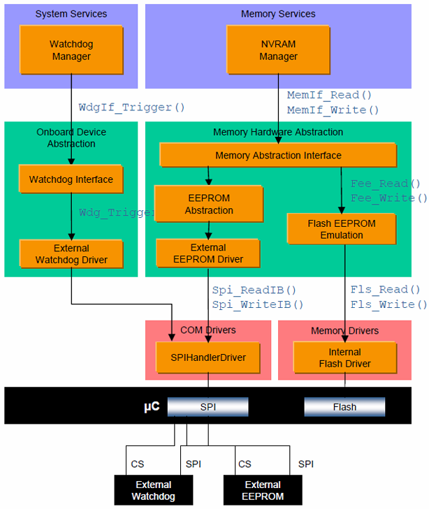
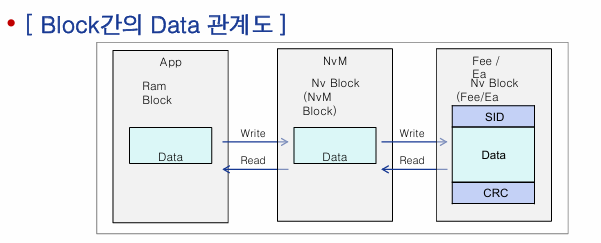

## AUTOSAR Memory Stack

Memory stack은 memory service, H/W Abstraction Driver Layer로 구성됨


## AUTOSAR Memory Basic Concept

- Basic Storage Object
  - NV block
    - EEPROM에 저장되는 Block으로 NV data와 선택적으로 CRC, block header로 구성되어 있다.

  - RAM block
    - Ram에 저장되는 Block으로 Ram data와 선택적으로 CRC, block header로 구성되어 있다
    - Ram Block은 전역변수(global data section) 로 선언해야 한다
    - Write 요청 후에는 Ram  Block의 Data를 저장해 두지 않기 때문에, 작업 완료 후까지 Ram Block의 data를 변경하면 안된다
  - ROM block
    - FLASH에 저장되는 값으로 NvBlock이 비어있거나, Data가 깨졌을 시 또는 default 값을 설정에 따라 App에게 제공한다.
  - Administrative block
    - NvM 내부에서 사용하는 관리 block으로 Block의 에러, 상태 등의 정보를 가지고 있다.
   ※ Block : EEPROM에 읽고 쓰는 단위



- NvM Block : app에서 EEPROM에 읽고 쓰는 논리적 단위
- Fee/Ea Block : 물리적으로 EEPROM에 읽고 쓰는 단위

Read : Page 단위, write보다 빠름
Write : Page 단위
Erase : Block 단위

### 계층별 역할

```text
SWC ─ RTE
       │  (Client-Server : NvM_Service)
     NvM (NVRAM Manager)      ← 블록 단위 관리, 작업 큐, CRC, 중복 저장
       │
     MemIf (Memory Abstraction Interface)  ← 아래가 Flash인지 EEPROM인지 숨김
       │                         │
     Fee (Flash EEPROM Emulation)   Ea (EEPROM Abstraction)
       │                         │
     Fls (Flash Driver)          Eep (EEPROM Driver)
```

- **Fee** : 실제 EEPROM이 없는 MCU에서 **Data Flash로 EEPROM을 흉내** 낸다. Flash는 덮어쓰기가 안 되고 지우기(Erase)를 섹터 단위로만 할 수 있으므로, 새 데이터를 빈 공간에 이어 쓰고 섹터가 차면 유효한 데이터만 옮긴 뒤 지운다. 이 과정이 쓰기 횟수를 분산시켜 **수명(Wear)** 도 관리한다.
- **Ea** : 외부 EEPROM 칩처럼 바이트/페이지 단위로 덮어쓸 수 있는 메모리를 추상화한다.

## AUTOSAR Service implemented by the NVRAM Manager

- Ports and Port Interface
  - NVRAM block당 하나의 Port 사용
  - SWC는 Client-Server 인터페이스 `NvM_Service`로 NvM의 기능을 호출한다.
  - 작업 완료는 Notification(`NvM_NotifyJobFinished`) 콜백으로 받는다.

### 주요 API

| API | 동작 |
| --- | --- |
| `NvM_ReadBlock` | NV Block → RAM Block으로 읽기 |
| `NvM_WriteBlock` | RAM Block → NV Block으로 쓰기 |
| `NvM_RestoreBlockDefaults` | ROM Block의 기본값을 RAM Block에 복원 |
| `NvM_GetErrorStatus` | 마지막 작업 결과 확인 (OK, PENDING, INTEGRITY_FAILED 등) |
| `NvM_SetRamBlockStatus` | RAM Block 값이 바뀌었음을 표시 (WriteAll 대상) |
| `NvM_ReadAll` / `NvM_WriteAll` | 시동 시 전체 읽기 / 종료 시 전체 쓰기 (EcuM이 호출) |

### 동작 방식

- NvM의 요청은 **비동기**다. `NvM_WriteBlock()`은 요청을 큐에 넣고 바로 반환하고, 실제 처리는 주기적으로 호출되는 `NvM_MainFunction()`에서 진행된다.
  - 그래서 앞에서 말한 것처럼 **작업이 끝나기 전에는 RAM Block을 변경하면 안 된다.**
- **ECU 생명주기와 연결**
  - 시동 : `NvM_ReadAll()`로 저장된 설정값을 RAM에 올린다. CRC가 깨졌으면 ROM 기본값을 쓴다.
  - 운행 중 : 값이 바뀌면 `SetRamBlockStatus`로 표시만 해 둔다. (Flash 쓰기 횟수 절약)
  - 종료 : `NvM_WriteAll()`로 바뀐 블록만 한 번에 저장한다.

### 블록 관리 방식

| 종류 | 설명 | 용도 |
| --- | --- | --- |
| Native | NV Block 1개 | 일반 데이터 |
| Redundant | 같은 데이터를 NV Block 2개에 저장 | 깨지면 안 되는 중요 데이터 |
| Dataset | 같은 형식의 블록 여러 개를 인덱스로 선택 | 프로파일, 여러 세트의 설정 |
