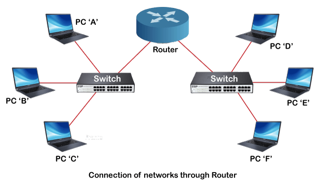

**C언어에서 하드웨어가 어떻게 제어되는가.**

CPU는 메모리를 읽어서 명령에 따라 하드웨어를 제어한다. 통신도 결국 같은 원리다. 소프트웨어가 데이터를 계층별로 포장해서 통신 컨트롤러의 레지스터/버퍼에 쓰면, 하드웨어가 전기 신호로 바꿔 내보낸다.

## 차량 SW 개발에서의 위치

CAN을 사용하는 건 이미 MCAL에 정의되어 있다. 나는 설계하고 검증하는 것.
오토에버는 MCU하고 BSW가 중요하다.
ASW는 소프트웨어로 봐지는 경우가 많다. 이건 MATLAB/Simulink, ASCET 같은 모델 기반 도구로 만드는 경우가 많다.

## OSI 7계층

| 계층 | 이름 | 역할 | 차량/네트워크 예시 |
| --- | --- | --- | --- |
| 7 | Application | 사용자 서비스 | UDS, SOME/IP, HTTP |
| 6 | Presentation | 데이터 표현, 암호화 | 직렬화(Serialization) |
| 5 | Session | 세션 관리 | |
| 4 | Transport | **어플리케이션 구분**, 신뢰성 | TCP, UDP (포트 번호), CAN TP |
| 3 | Network | 경로 선택, 논리 주소 | IP |
| 2 | Data Link | 프레임, 물리 주소, 매체 접근 제어 | Ethernet MAC, CAN Controller |
| 1 | Physical | 전기 신호 | 100BASE-T1 PHY, CAN Transceiver |

- transport : 어플리케이션을 구분 짓는다. 같은 IP 주소로 온 데이터라도 **포트 번호**로 어떤 프로그램에 줄지 결정한다.
- `Data Link Layer는 '반도체'이다.` 이더넷 MAC, CAN 컨트롤러처럼 MCU 안의 하드웨어 블록이 이 계층을 처리한다.
- `TCP/IP는 운영체제에서 정의된다.` 리눅스 커널이나 AUTOSAR의 TcpIp 모듈 같은 소프트웨어가 3~4계층을 처리한다.

## TCP/IP

TCP/IP 모델은 OSI의 7계층을 4계층(Network Access, Internet, Transport, Application)으로 단순화한 실제 인터넷 모델이다.

### IP

- IP는 소스로부터 목적지까지 패킷을 전달한다. (경로 선택은 라우터가 한다.)
- IP 헤더의 Total Length 필드가 16비트라서, 한 IP 패킷은 최대 2^16 - 1 = 65,535바이트까지 담을 수 있다. 실제로는 이더넷 MTU(보통 1500바이트)에 맞춰 나눠서(Fragmentation) 보낸다.
- **신뢰성을 보장하지 않는다.** 손실, 중복, 순서 뒤바뀜은 상위 계층이 처리한다.

### UDP

UDP는 데이터가 잘 도착했음을 가정한다. 순서와 무결성(재전송)도 보장하지 않는다. 그래서 빠르다.

- 연결 설정이 없고 헤더가 8바이트로 작다.
- 실시간 스트리밍, 주기적으로 갱신되는 센서 값(하나 잃어버려도 다음 값이 곧 옴), SOME/IP 이벤트, DoIP의 차량 탐색에 쓰인다.

### TCP

- **연결 지향** : 3-way handshake(SYN → SYN/ACK → ACK)로 연결을 맺은 뒤 통신한다.
- **신뢰성** : 순서 번호(Sequence Number)와 확인 응답(ACK)으로 손실된 세그먼트를 재전송하고, 순서를 맞춰 전달한다.
- **흐름 제어 / 혼잡 제어** : 수신자의 처리 능력(윈도우)과 네트워크 상태에 맞춰 전송량을 조절한다.
- 데이터가 하나도 빠지면 안 되는 SW 다운로드(DoIP 진단), 설정 전송 등에 쓰인다.

| 구분 | TCP | UDP |
| --- | --- | --- |
| 연결 | 연결 지향 | 비연결 |
| 신뢰성 | 재전송, 순서 보장 | 없음 |
| 속도/오버헤드 | 느림, 헤더 20바이트 이상 | 빠름, 헤더 8바이트 |
| 용도 | 진단, 파일 전송 | 스트리밍, 주기 데이터 |

### 패킷이 이동하는 방식

R1, R2 라우터에서의 패킷 흐름 예시가 교재 128p에 있는데 이 정도는 상식으로 알고 있어야 한다.

IP 주소를 중심으로 이동하지만 결국 그 속에서 1 hop은 MAC 주소를 기반으로 움직인다.

1. 출발지는 목적지 IP가 같은 네트워크가 아니면, 패킷을 **기본 게이트웨이(라우터)** 로 보낸다.
2. 이때 이더넷 프레임의 목적지 MAC은 최종 목적지가 아니라 **라우터의 MAC**이다.
3. 라우터는 프레임을 벗기고 IP를 보고 다음 경로를 정한 뒤, 다음 hop의 MAC으로 **새 프레임**을 만들어 보낸다.
4. 마지막에 ARP라는 통신을 사용해서 목적지 IP에 해당하는 MAC을 찾는다.

즉 **IP 주소는 끝까지 그대로, MAC 주소는 hop마다 바뀐다.**

MAC 주소는 전체 네트워크에서 고유할 필요는 없으나 **한 스위치의 망**에서는 고유해야 한다.

### MAC Control

Data Link에서 가장 중요한 기능이 MAC(Medium Access Control)로, 여러 장치가 같은 매체를 쓸 때 충돌하지 않도록 제어하는 것이다.

- **CSMA/CD** : 예전 허브 기반 이더넷은 한 선을 공유했기 때문에, 전송 전 채널을 감지하고(Carrier Sense) 충돌이 나면 감지 후(Collision Detection) 임의 시간 뒤 재전송했다.
- **스위치 기반 Full-Duplex** : 현재 이더넷은 장치마다 스위치 포트와 1:1로 연결되고 송수신 선이 분리되어 **충돌 자체가 생기지 않는다.** 대신 스위치 내부 큐에서 대기(지연)가 생기며, 이를 관리하는 것이 TSN의 역할이다.
- **CAN의 방식** : CAN은 충돌을 피하는 대신 **비트 중재(Arbitration)** 로 해결한다. 동시에 보내도 ID가 낮은 메시지가 손실 없이 이긴다.
- 차량용 10BASE-T1S는 한 선을 여러 노드가 공유하므로, 충돌 없이 순서대로 전송 기회를 주는 **PLCA(Physical Layer Collision Avoidance)** 를 사용한다.
