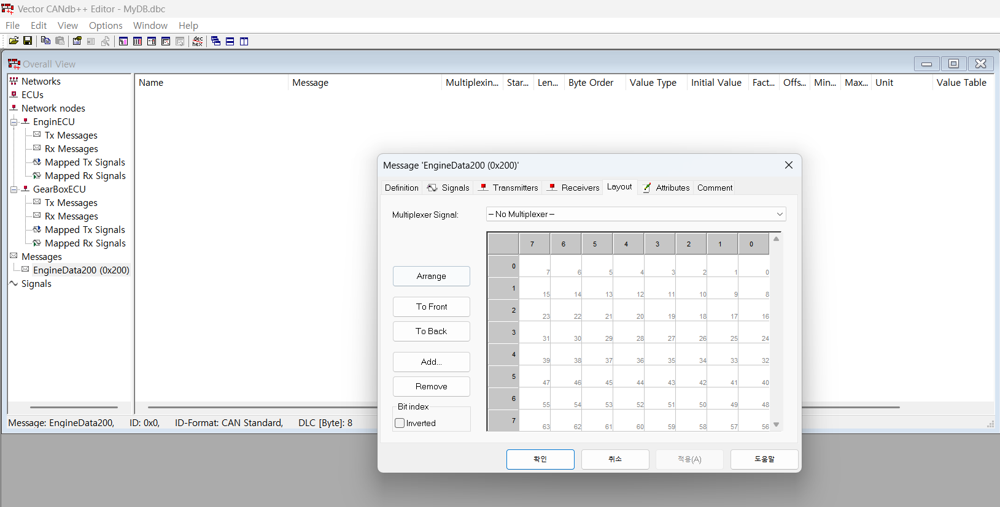
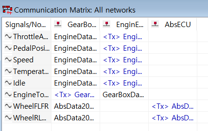
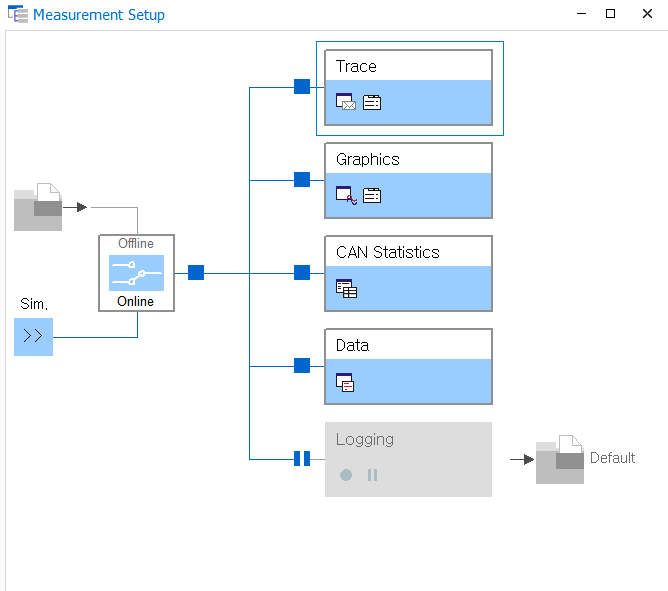
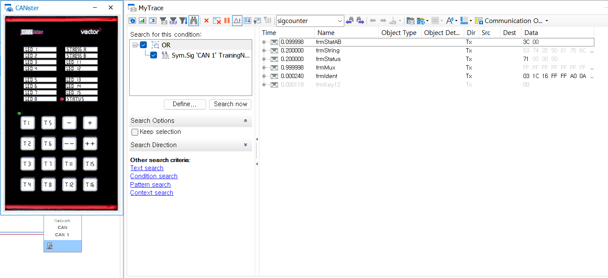
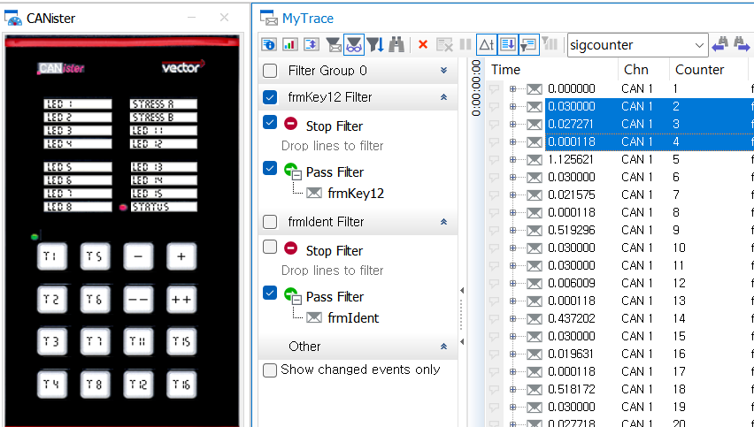
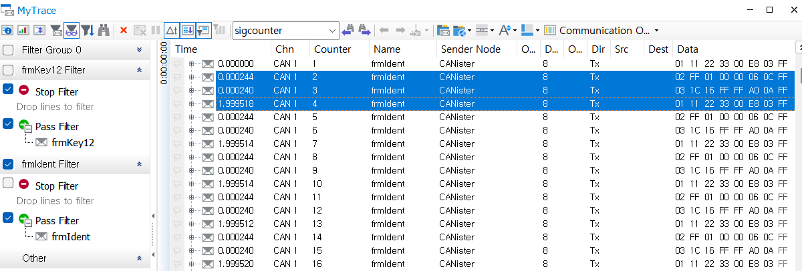
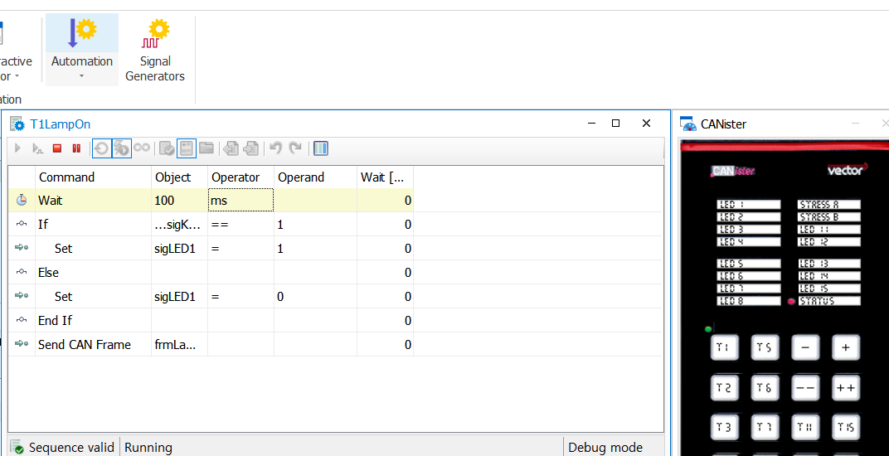

[차량용 통신](/2025-01-24-차량용통신/)에서 정리한 이론을 Vector 도구로 직접 실습했다.

## Vector 도구 비교

- **CANape** : ECU Calibration. ECU 내부 변수를 측정하고 파라미터를 튜닝(XCP/CCP)
- **CANoe** : Network. 장비와 사람의 가상 생성이 가능하다. (측정 + 시뮬레이션 + 테스트)
- **CANalyzer** : Network. 가상은 안 된다. 실제 버스를 측정·분석하는 용도

## 1. CANdb++ 활용한 기초 실습

CANdb++ Editor로 네트워크 데이터베이스(DBC)를 직접 만들었다.



- **Network nodes** : `EnginECU`, `GearBoxECU`, `AbsECU` 노드 생성
- **Messages** : `EngineData200 (0x200)`, DLC 8바이트, 표준 ID
- **Signals** : `ThrottlePosition`, `PedalPosition`, `Speed`, `Temperature`, `Idle` 등을 만들고, Layout 탭에서 **64비트 중 어느 위치에 몇 비트로 놓을지** 배치한다.
- 노드의 Tx Messages에 메시지를 연결해야 누가 보내는 메시지인지 정의된다.



Communication Matrix에서 **신호별로 어떤 ECU가 송신(Tx)하고 어떤 ECU가 수신하는지** 한눈에 확인할 수 있다. 실제 차량 개발에서는 이 매트릭스가 ECU 간 통신 인터페이스 합의서 역할을 한다.

## 2. Measurement Setup



각 measurement에 따라 실습을 진행한다.

- 왼쪽에서 데이터가 들어온다. **Online**(실제/시뮬레이션 버스)과 **Offline**(저장된 로그 파일 재생) 중 선택한다.
- 오른쪽 블록이 분석 창이다. Trace(메시지 목록), Graphics(신호 그래프), CAN Statistics(버스 부하, 에러), Data(신호 값), Logging(파일 저장)
- 블록 사이의 사각형 지점에 **필터**를 끼워 넣어 특정 창에만 원하는 메시지가 가도록 할 수 있다.

## 3. Trace 분석



CANister(Vector 교육용 가상 ECU 패널)를 연결하고 Trace에서 메시지를 관찰했다. `frmStatAB`, `frmString`, `frmStatus`, `frmMux`, `frmIdent`, `frmKey12` 등 각 메시지의 **주기, 데이터 길이, 송신 패턴**을 Trace만 보고 알아내는 것이 과제였다.

### frmKey12



1. 주기 30ms
2. data length 1
3. 패턴 3

Pass Filter로 `frmKey12`만 남기고 보면, 시간 간격(Δt)이 `0.030 → 0.027 → 0.0001`처럼 **3개가 한 묶음**으로 반복되고, 묶음 사이에는 긴 간격이 있다.

### frmIdent



1. 주기 2s
2. data length 8
3. 패턴 3

- 첫 바이트가 `01`, `02`, `03`으로 바뀌며 **같은 ID로 서로 다른 내용 3종류**를 보낸다. 3개가 연달아 나간 뒤 약 2초 쉰다.
- 이것이 **멀티플렉서(Multiplexer)** 다. 멀티플렉서 기능은 ID 재사용 기능이다.
  - 첫 바이트(Multiplexer 신호) 값에 따라 나머지 바이트의 의미가 달라진다.
  - CAN ID는 우선순위이자 한정된 자원이라, 자주 바뀌지 않는 정보(식별 정보, 버전 등)는 하나의 ID를 나눠 쓴다.

Trace 화면의 Δt(이전 같은 메시지와의 시간 차)를 보는 습관이 중요하다. 주기 메시지가 흔들리면(지터) 송신 ECU의 태스크 부하나 버스 부하를 의심할 수 있다.

## 4. Automation



잘 사용하는 기능은 아니지만 가볍게 특정 기능 체크 하기 좋다.

CAPL 코드를 쓰지 않고 **표 형식으로 동작 순서를 만드는 기능**이다. 위 예시(`T1LampOn`)는 다음 로직이다.

```text
100ms 대기
if (키 신호 == 1)  → sigLED1 = 1
else               → sigLED1 = 0
LED 프레임 송신
```

CANister의 T1 버튼을 누르면 LED1이 켜지는 것을 확인했다. 복잡한 시나리오는 CAPL이나 Test Module(vTESTstudio)로 작성하고, Automation은 **간단한 반복 확인**에 쓰는 것이 적당하다.

## 다음 단계 : DDS / SOME/IP

CAN은 신호를 브로드캐스트하는 방식이라면, 이더넷 기반의 **SOME/IP**와 **DDS**는 필요한 서비스만 주고받는 **서비스 지향 통신**이다. CANoe에서도 ARXML을 불러와 SOME/IP 서비스를 시뮬레이션할 수 있다. 정리한 내용은 [Automotive Ethernet (1)](/2025-03-19-automotive_ethernet/)에 있다.
