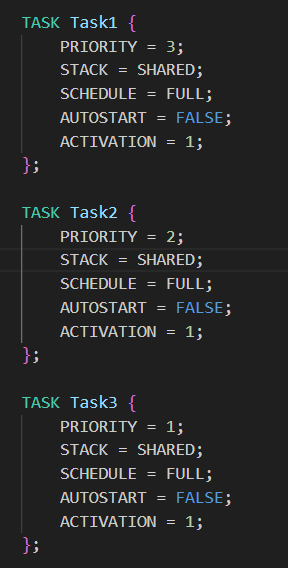
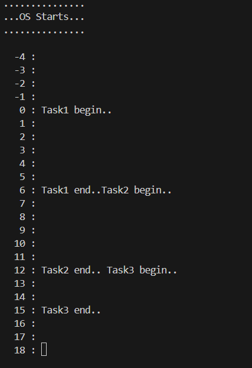
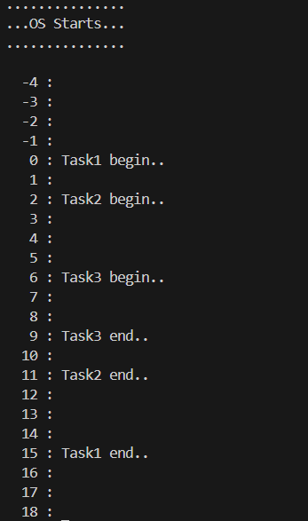

같은 코드에서 **태스크 우선순위만 바꿨을 때 실행 흐름이 어떻게 달라지는지** 확인하는 실습이다. (TC275 + OSEK 호환 OS, [과목 정리](/2025-04-07-A_RTOS_정리/))

## 코드

1초마다 타이머 인터럽트(Category 2 ISR)가 카운트를 출력하고, 카운트가 0이 되면 Task1을 활성화한다.
각 태스크는 `mdelay()`로 일정 시간 동안 CPU를 사용하면서 중간에 다른 태스크를 활성화한다.

``` c
#include "bsw.h"
ISR2(TimerISR){
    static int c = -5;
    c++;
    osEE_tc_stm_set_sr0_next_match(1000000U);

    printfSerial("\n%4d : ", c);
    if(c==0){
        ActivateTask(Task1);
    }
}

TASK(Task1){
    printfSerial("Task1 begin..");
    mdelay(2000);
    ActivateTask(Task2);
    mdelay(4000);
    printfSerial("Task1 end..");
    TerminateTask(); // return 이라고 보면 된다.
}

TASK(Task2){
    printfSerial("Task2 begin.. ");
    mdelay(4000);
    ActivateTask(Task3);
    mdelay(2000);
    printfSerial("Task2 end.. ");
    TerminateTask(); // return 이라고 보면 된다.
}

TASK(Task3){
    printfSerial("Task3 begin.. ");
    mdelay(3000);
    printfSerial("Task3 end.. ");
    
    TerminateTask(); // return 이라고 보면 된다.
}
```

- `ActivateTask()`는 태스크를 **Ready 상태로 만들 뿐**이다. 바로 실행될지는 우선순위가 결정한다.
- `TerminateTask()`로 끝나지 않고 함수가 그냥 반환되면 OSEK에서는 오류다. 태스크는 반드시 스스로 종료해야 한다.
- 각 태스크는 `mdelay()` 동안 CPU를 계속 사용한다. 선점당한 동안에는 시간이 흐르지 않고, 다시 실행되면 남은 시간만큼 이어서 실행된다.

## 실험 1 : Task1 > Task2 > Task3

OIL 파일에서 우선순위를 다음과 같이 설정했다. (숫자가 클수록 높은 우선순위)



- `SCHEDULE = FULL` : 완전 선점형
- `AUTOSTART = FALSE` : 부팅 시 자동 시작하지 않고 ISR에서 활성화
- `ACTIVATION = 1` : 동시에 하나만 Ready 상태가 될 수 있음



```text
 0 : Task1 시작
 2 : Task1이 Task2 활성화 → Task2가 더 낮으므로 Ready에서 대기, Task1 계속
 6 : Task1 종료 → Task2 시작
10 : Task2가 Task3 활성화 → Task3가 더 낮으므로 대기
12 : Task2 종료 → Task3 시작
15 : Task3 종료
```

나중에 활성화된 태스크가 모두 우선순위가 낮으니, **선점 없이 순서대로** 실행된다.

## 실험 2 : Task1 < Task2 < Task3

우선순위를 반대로 바꾸면 결과가 완전히 달라진다.



```text
 0 : Task1 시작
 2 : Task1이 Task2 활성화 → Task2가 더 높으므로 즉시 선점, Task2 시작
 6 : Task2가 Task3 활성화 → Task3가 선점, Task3 시작
 9 : Task3 종료 → Task2 재개 (남은 2초)
11 : Task2 종료 → Task1 재개 (남은 4초)
15 : Task1 종료
```

- 활성화하는 순간 더 높은 우선순위 태스크에게 CPU를 빼앗기고(선점), 끝나면 **중단된 지점부터 이어서** 실행된다.
- 전체 종료 시점(15초)은 같지만, **각 태스크가 끝나는 시점(응답 시간)** 이 크게 바뀐다.
  - 실험 1에서 Task3는 활성화(10초) 후 5초 뒤에 끝났지만, 실험 2에서는 활성화(6초) 후 3초 만에 끝났다.

## 정리

우선순위에 따라 task의 흐름이 달라지는 것을 확인할 수 있다.

- 우선순위는 "중요도"가 아니라 **응답 시간 요구**에 따라 정해야 한다. 데드라인이 짧은 태스크가 높은 우선순위를 가져야 한다. (Rate Monotonic의 아이디어)
- 선점이 일어나면 공유 데이터 보호가 필요해진다. 이때 생길 수 있는 문제가 [우선순위 역전](/2025-03-20-우선순위역전현상/)이다.
