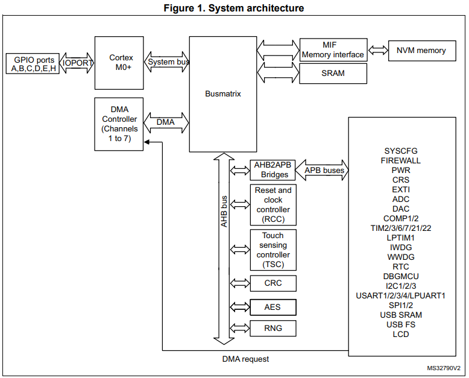
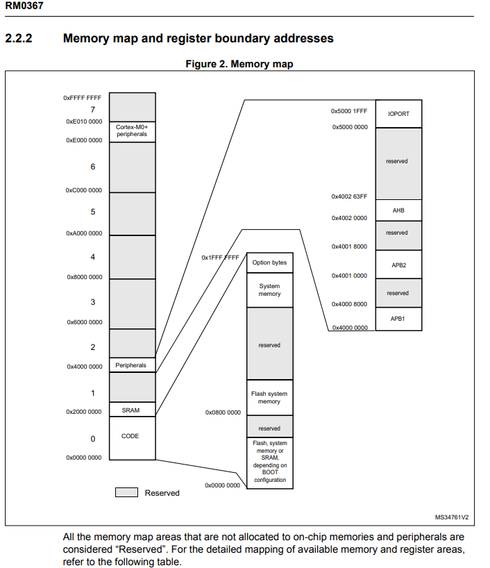
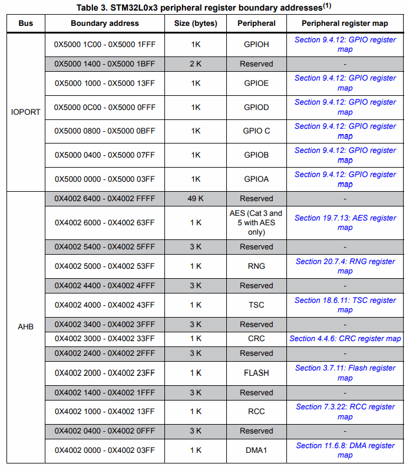
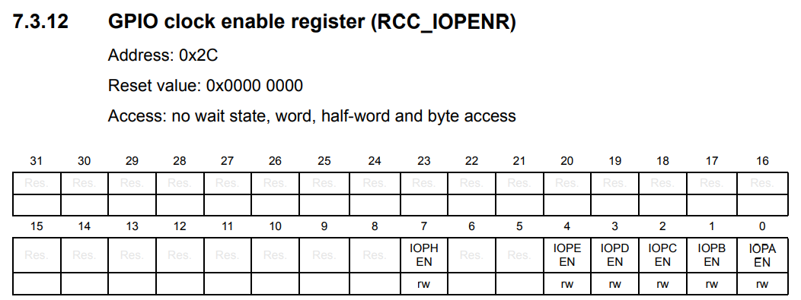

## MCU Bring-Up
Firmware를 통해 MCU가 기본적으로 동작하는 것

새 보드를 받으면 보통 다음 순서로 확인한다.

1. 전원과 디버거 연결 (보드가 인식되고 Flash에 쓸 수 있는가)
2. **클럭 설정** (RCC) : 원하는 시스템 클럭으로 동작하는가
3. **GPIO로 LED 토글** : 코드가 실제로 실행되는가 (임베디드의 Hello World)
4. UART 출력 : 디버깅 통로 확보 ([STM32 UART](/2025-02-28-STM32_UART/))
5. 인터럽트, 타이머, 나머지 주변장치


## I/O Access 방법
- **Special Instruction I/O (Port-mapped I/O)**
  - I/O 전용 주소 공간과 전용 명령어(`in`, `out`)로 접근한다. (x86)
- **Memory-mapped I/O**
  - 주변장치 레지스터가 메모리 주소 공간에 배치되어, 일반 Load/Store 명령으로 접근한다. ARM 기반 MCU는 모두 이 방식이다.
  - SPI/I2C/UART 등 통신 주변장치의 데이터 레지스터도 이 방식으로 읽고 쓴다.
- **Direct Memory Access (DMA)**
  - CPU 개입 없이 DMA 컨트롤러가 주변장치 ↔ 메모리 간 데이터를 옮긴다. 대량 데이터(ADC 연속 변환, UART 수신 버퍼)에 쓴다.


## 저항
- PULL UP
- PULL DOWN
Pull up을 더 많이 쓴다. 눌렀을 때 GND에 직접 연결되어 0이 되기 때문에 더 확실하게 구분이 가능하다. 만일 Pull Down일 경우 눌렀을 때 1인데 이 때 voltage의 threshold를 정확하게 분간하기 어려운 경우도 있기 때문
- Open Drain

## clock의 생성
Reset and Clock Controller




1. stm32nucleo user sheet 에서 stm32 pin 번호 확인
2. RCC register Map setting 


## Little Endian vs Big Endian

여러 바이트로 된 값을 메모리에 저장하는 **바이트 순서**다. `0x12345678`을 0x2000_0000 주소에 저장하면,

| 주소 | +0 | +1 | +2 | +3 |
| --- | --- | --- | --- | --- |
| Little Endian | `78` | `56` | `34` | `12` |
| Big Endian | `12` | `34` | `56` | `78` |

- **Little Endian** : 낮은 주소에 하위 바이트. ARM Cortex-M(STM32), x86, TriCore 등 대부분의 MCU
- **Big Endian** : 낮은 주소에 상위 바이트. 네트워크 바이트 순서(TCP/IP), 일부 PowerPC MCU
- 통신에서 특히 중요하다. CAN 신호의 **Intel(Little) / Motorola(Big)** 바이트 순서를 잘못 맞추면 값이 엉뚱하게 해석된다.

```c
uint32_t x = 0x12345678;
uint8_t *p = (uint8_t *)&x;
printf("%02X
", p[0]);   /* Little Endian이면 78 */
```

## Memory Map



레퍼런스 매뉴얼 60page의 메모리 맵을 보면 주변장치마다 주소 범위가 정해져 있다.
GPIO A~H까지 포트별로 주소 블록이 나뉘어 있다.

GPIOA 0X5000 0000 - 0X5000 03FF
RCC 0X4002 1000 - 0X4002 13FF
=> RCC_IOPENR

여기보면 IOPAEN을 열어줘야 GPIOA가 사용가능함.
- Reset and Clock Control(RCC)
  -  리셋과 클럭을 제어하는 장치로 STM32에서 사용
  - MCU의 리셋과 클럭을 제어
  - 입력 클럭을 제어
  - 시스템 클럭(SYSCLK)을 동작시키는 소스 클럭을 설정
  - Clock의 환경설정


MPU에서 제공하는 기본적인 기능
- GPIO
- SYSTICK
- NVIC
- PWR
- RCC
- FLASH
HAL(Hardware Abstraction Layer) 드라이버는 CubeMX가 생성해 주는 ST의 라이브러리다. 파일 드라이버의 사용법과는 조금 다를 수도 있다. 중요하지만 불규칙한 문법을 가진 API이다.

- 이름 끝에 `_IT`가 붙은 함수들은 interrupt를 사용하는 함수들이고(non-blocking), 없으면 blocking 함수들이다. `_DMA`는 DMA를 사용한다.
- 인터럽트가 발생하면 `xxx_IRQHandler()` → `HAL_xxx_IRQHandler()` → 사용자 콜백(`HAL_xxx_Callback()`) 순서로 호출된다.
IRQHandler

## Polling vs interrupt

| 구분 | Polling | Interrupt |
| --- | --- | --- |
| 방식 | CPU가 반복해서 상태를 확인 | 이벤트가 생기면 하드웨어가 CPU에 알림 |
| 장점 | 단순, 타이밍 예측 쉬움 | CPU가 다른 일을 할 수 있음, 빠른 응답 |
| 단점 | CPU 낭비, 이벤트 놓칠 수 있음 | 공유 데이터 보호 필요, 디버깅 어려움 |

인터럽트는 짧아야 한다. ISR이 길면 그동안 다른 인터럽트와 메인 코드가 멈춘다. ISR에서는 플래그만 세우고 처리는 메인 루프에서 한다.


``` C
BSP_PB_Init(BUTTON_KEY,BUTTON_MODE_GPIO);
	
//	GPIO_TypeDef* BUTTON_PORT[BUTTONn] = {USER_BUTTON_GPIO_PORT }; 
	
//	BUTTON_PIN[BUTTONn] = {USER_BUTTON_PIN }; 
//	BUTTON_IRQn[BUTTONn] = {USER_BUTTON_EXTI_IRQn };
	
  while (1)
  {
    /* USER CODE END WHILE */
		switch (BSP_PB_GetState(BUTTON_USER)){
			case 0:
				BSP_LED_On(LED8);
				break;
			case 1:
				BSP_LED_Off(LED8);
				break;
			}
    /* USER CODE BEGIN 3 */
  }


  	//button
	//	GPIO_InitTypeDef GPIO_init;
//	GPIO_init.Mode = 0x1 << 4 ;
//	GPIO_init.Pull = GPIO_NOPULL;
//	GPIO_init.Pin = GPIO_PIN_5;
//	GPIO_init.Speed = GPIO_SPEED_FREQ_LOW ;
//	GPIO_init.Alternate = GPIO_
//	HAL_GPIO_Init(GPIOA, &GPIO_init);
	
//	GPIO_TypeDef* BUTTON_PORT[BUTTONn] = {USER_BUTTON_GPIO_PORT }; 
	
//	BUTTON_PIN[BUTTONn] = {USER_BUTTON_PIN }; 
//	BUTTON_IRQn[BUTTONn] = {USER_BUTTON_EXTI_IRQn };
```

`HAL_InitTick()`은 SysTick 타이머를 1ms마다 인터럽트가 발생하도록 설정한다. (`SystemCoreClock / 1000`을 reload 값으로 사용)
`HAL_Delay()`, `HAL_GetTick()` 같은 tick 관련 함수들은 `stm32xxx_hal.c`에 다 구현되어 있다. SysTick 인터럽트마다 `uwTick`이 1씩 증가하는 구조다.


``` C
/* USER CODE BEGIN Header */
/**
  ******************************************************************************
  * @file           : main.c
  * @brief          : Main program body
  ******************************************************************************
  * @attention
  *
  * Copyright (c) 2025 STMicroelectronics.
  * All rights reserved.
  *
  * This software is licensed under terms that can be found in the LICENSE file
  * in the root directory of this software component.
  * If no LICENSE file comes with this software, it is provided AS-IS.
  *
  ******************************************************************************
  */
/* USER CODE END Header */
/* Includes ------------------------------------------------------------------*/
#include "main.h"

/* Private includes ----------------------------------------------------------*/
/* USER CODE BEGIN Includes */
#include "stm32l0xx_nucleo.h"

/* USER CODE END Includes */

/* Private typedef -----------------------------------------------------------*/
/* USER CODE BEGIN PTD */

/* USER CODE END PTD */

/* Private define ------------------------------------------------------------*/
/* USER CODE BEGIN PD */

/* USER CODE END PD */

/* Private macro -------------------------------------------------------------*/
/* USER CODE BEGIN PM */

/* USER CODE END PM */

/* Private variables ---------------------------------------------------------*/
TIM_HandleTypeDef htim3;
TIM_HandleTypeDef htim7;

/* USER CODE BEGIN PV */
volatile int vib_cnt=0;
volatile int bnt=0;  // volatile 
volatile int light_state = 4;
/* USER CODE END PV */

/* Private function prototypes -----------------------------------------------*/
void SystemClock_Config(void);
static void MX_GPIO_Init(void);
static void MX_TIM7_Init(void);
static void MX_TIM3_Init(void);
/* USER CODE BEGIN PFP */
void HAL_TIM_PeriodElapsedCallback(TIM_HandleTypeDef *htim)
{
  if(htim->Instance == TIM7)
  {
//    HAL_GPIO_TogglePin(GPIOA,GPIO_PIN_8);
		switch (light_state){
			case 1:
				light_state = 2;
				break;
			case 2:
				light_state = 3;
				break;
			case 3:
				light_state = 4;
				break;
			case 4:
				light_state = 1;
				break;
			
		}
  }
	if(htim->Instance == TIM3)
	{
			HAL_GPIO_TogglePin(GPIOA, GPIO_PIN_8);
	}
}

void HAL_GPIO_EXTI_Callback(uint16_t GPIO_Pin){
   switch (GPIO_Pin){
      case GPIO_PIN_13:
				bnt = 1;
//         HAL_GPIO_TogglePin(GPIOA,GPIO_PIN_8);
         break;
      case GPIO_PIN_5:
				vib_cnt++;
         break;
   }
}


/* USER CODE END PFP */

/* Private user code ---------------------------------------------------------*/
/* USER CODE BEGIN 0 */

/* USER CODE END 0 */

/**
  * @brief  The application entry point.
  * @retval int
  */
int main(void)
{

  /* USER CODE BEGIN 1 */

  /* USER CODE END 1 */

  /* MCU Configuration--------------------------------------------------------*/

  /* Reset of all peripherals, Initializes the Flash interface and the Systick. */
  HAL_Init();

  /* USER CODE BEGIN Init */

  /* USER CODE END Init */

  /* Configure the system clock */
  SystemClock_Config();

  /* USER CODE BEGIN SysInit */

  /* USER CODE END SysInit */

  /* Initialize all configured peripherals */
  MX_GPIO_Init();
  MX_TIM7_Init();
  MX_TIM3_Init();
  /* USER CODE BEGIN 2 */
	
	BSP_PB_Init(BUTTON_KEY,BUTTON_MODE_EXTI);
	HAL_TIM_Base_Start_IT(&htim7);
	HAL_TIM_PWM_Start(&htim3, TIM_CHANNEL_3);
	
  /* USER CODE END 2 */

  /* Infinite loop */
  /* USER CODE BEGIN WHILE */
	HAL_GPIO_WritePin(GPIOA,GPIO_PIN_8, 0x1);

  while (1)
  {
    /* USER CODE END WHILE */
    /* USER CODE BEGIN 3 */
		
		
		switch (light_state){
			case 1:
				__HAL_TIM_SetCompare(&htim3, TIM_CHANNEL_3, 500);
				break;
			case 2:
				__HAL_TIM_SetCompare(&htim3, TIM_CHANNEL_3, 500);
				break;
			case 3:
				__HAL_TIM_SetCompare(&htim3, TIM_CHANNEL_3, 500);
				break;
			case 4:
				__HAL_TIM_SetCompare(&htim3, TIM_CHANNEL_3, 500);
				break;
			default:
				__HAL_TIM_SetCompare(&htim3, TIM_CHANNEL_3, 500);
				break;
		}
      if(bnt==1){
         HAL_GPIO_TogglePin(GPIOA,GPIO_PIN_8);
         bnt=0;
      }
      if(vib_cnt> 100){
         HAL_GPIO_TogglePin(GPIOA,GPIO_PIN_5);
         HAL_Delay(100);
         HAL_GPIO_TogglePin(GPIOA,GPIO_PIN_5);
         HAL_Delay(100);
         HAL_GPIO_TogglePin(GPIOA,GPIO_PIN_5);
         HAL_Delay(100);
         HAL_GPIO_TogglePin(GPIOA,GPIO_PIN_5);
				 HAL_Delay(100);
         HAL_GPIO_TogglePin(GPIOA,GPIO_PIN_5);
				HAL_Delay(100);
         HAL_GPIO_TogglePin(GPIOA,GPIO_PIN_5);
				HAL_Delay(100);
         HAL_GPIO_TogglePin(GPIOA,GPIO_PIN_5);
         vib_cnt=0;
      }
  }
  /* USER CODE END 3 */
}

/**
  * @brief System Clock Configuration
  * @retval None
  */
void SystemClock_Config(void)
{
  RCC_OscInitTypeDef RCC_OscInitStruct = {0};
  RCC_ClkInitTypeDef RCC_ClkInitStruct = {0};

  /** Configure the main internal regulator output voltage
  */
  __HAL_PWR_VOLTAGESCALING_CONFIG(PWR_REGULATOR_VOLTAGE_SCALE1);

  /** Initializes the RCC Oscillators according to the specified parameters
  * in the RCC_OscInitTypeDef structure.
  */
  RCC_OscInitStruct.OscillatorType = RCC_OSCILLATORTYPE_HSE;
  RCC_OscInitStruct.HSEState = RCC_HSE_BYPASS;
  RCC_OscInitStruct.PLL.PLLState = RCC_PLL_NONE;
  if (HAL_RCC_OscConfig(&RCC_OscInitStruct) != HAL_OK)
  {
    Error_Handler();
  }

  /** Initializes the CPU, AHB and APB buses clocks
  */
  RCC_ClkInitStruct.ClockType = RCC_CLOCKTYPE_HCLK|RCC_CLOCKTYPE_SYSCLK
                              |RCC_CLOCKTYPE_PCLK1|RCC_CLOCKTYPE_PCLK2;
  RCC_ClkInitStruct.SYSCLKSource = RCC_SYSCLKSOURCE_HSE;
  RCC_ClkInitStruct.AHBCLKDivider = RCC_SYSCLK_DIV1;
  RCC_ClkInitStruct.APB1CLKDivider = RCC_HCLK_DIV1;
  RCC_ClkInitStruct.APB2CLKDivider = RCC_HCLK_DIV1;

  if (HAL_RCC_ClockConfig(&RCC_ClkInitStruct, FLASH_LATENCY_0) != HAL_OK)
  {
    Error_Handler();
  }
}

/**
  * @brief TIM3 Initialization Function
  * @param None
  * @retval None
  */
static void MX_TIM3_Init(void)
{

  /* USER CODE BEGIN TIM3_Init 0 */

  /* USER CODE END TIM3_Init 0 */

  TIM_ClockConfigTypeDef sClockSourceConfig = {0};
  TIM_MasterConfigTypeDef sMasterConfig = {0};
  TIM_OC_InitTypeDef sConfigOC = {0};

  /* USER CODE BEGIN TIM3_Init 1 */

  /* USER CODE END TIM3_Init 1 */
  htim3.Instance = TIM3;
  htim3.Init.Prescaler = 8-1;
  htim3.Init.CounterMode = TIM_COUNTERMODE_UP;
  htim3.Init.Period = 4000-1;
  htim3.Init.ClockDivision = TIM_CLOCKDIVISION_DIV1;
  htim3.Init.AutoReloadPreload = TIM_AUTORELOAD_PRELOAD_DISABLE;
  if (HAL_TIM_Base_Init(&htim3) != HAL_OK)
  {
    Error_Handler();
  }
  sClockSourceConfig.ClockSource = TIM_CLOCKSOURCE_INTERNAL;
  if (HAL_TIM_ConfigClockSource(&htim3, &sClockSourceConfig) != HAL_OK)
  {
    Error_Handler();
  }
  if (HAL_TIM_PWM_Init(&htim3) != HAL_OK)
  {
    Error_Handler();
  }
  sMasterConfig.MasterOutputTrigger = TIM_TRGO_RESET;
  sMasterConfig.MasterSlaveMode = TIM_MASTERSLAVEMODE_DISABLE;
  if (HAL_TIMEx_MasterConfigSynchronization(&htim3, &sMasterConfig) != HAL_OK)
  {
    Error_Handler();
  }
  sConfigOC.OCMode = TIM_OCMODE_PWM1;
  sConfigOC.Pulse = 0;
  sConfigOC.OCPolarity = TIM_OCPOLARITY_HIGH;
  sConfigOC.OCFastMode = TIM_OCFAST_DISABLE;
  if (HAL_TIM_PWM_ConfigChannel(&htim3, &sConfigOC, TIM_CHANNEL_3) != HAL_OK)
  {
    Error_Handler();
  }
  /* USER CODE BEGIN TIM3_Init 2 */

  /* USER CODE END TIM3_Init 2 */
  HAL_TIM_MspPostInit(&htim3);

}

/**
  * @brief TIM7 Initialization Function
  * @param None
  * @retval None
  */
static void MX_TIM7_Init(void)
{

  /* USER CODE BEGIN TIM7_Init 0 */

  /* USER CODE END TIM7_Init 0 */

  TIM_MasterConfigTypeDef sMasterConfig = {0};

  /* USER CODE BEGIN TIM7_Init 1 */

  /* USER CODE END TIM7_Init 1 */
  htim7.Instance = TIM7;
  htim7.Init.Prescaler = 800-1;
  htim7.Init.CounterMode = TIM_COUNTERMODE_UP;
  htim7.Init.Period = 10000-1;
  htim7.Init.AutoReloadPreload = TIM_AUTORELOAD_PRELOAD_DISABLE;
  if (HAL_TIM_Base_Init(&htim7) != HAL_OK)
  {
    Error_Handler();
  }
  sMasterConfig.MasterOutputTrigger = TIM_TRGO_RESET;
  sMasterConfig.MasterSlaveMode = TIM_MASTERSLAVEMODE_DISABLE;
  if (HAL_TIMEx_MasterConfigSynchronization(&htim7, &sMasterConfig) != HAL_OK)
  {
    Error_Handler();
  }
  /* USER CODE BEGIN TIM7_Init 2 */

  /* USER CODE END TIM7_Init 2 */

}

/**
  * @brief GPIO Initialization Function
  * @param None
  * @retval None
  */
static void MX_GPIO_Init(void)
{
  GPIO_InitTypeDef GPIO_InitStruct = {0};
/* USER CODE BEGIN MX_GPIO_Init_1 */
/* USER CODE END MX_GPIO_Init_1 */

  /* GPIO Ports Clock Enable */
  __HAL_RCC_GPIOC_CLK_ENABLE();
  __HAL_RCC_GPIOH_CLK_ENABLE();
  __HAL_RCC_GPIOB_CLK_ENABLE();
  __HAL_RCC_GPIOA_CLK_ENABLE();

  /*Configure GPIO pin : PC13 */
  GPIO_InitStruct.Pin = GPIO_PIN_13;
  GPIO_InitStruct.Mode = GPIO_MODE_IT_RISING;
  GPIO_InitStruct.Pull = GPIO_NOPULL;
  HAL_GPIO_Init(GPIOC, &GPIO_InitStruct);

  /*Configure GPIO pin : PB5 */
  GPIO_InitStruct.Pin = GPIO_PIN_5;
  GPIO_InitStruct.Mode = GPIO_MODE_IT_RISING;
  GPIO_InitStruct.Pull = GPIO_PULLUP;
  HAL_GPIO_Init(GPIOB, &GPIO_InitStruct);

  /* EXTI interrupt init*/
  HAL_NVIC_SetPriority(EXTI4_15_IRQn, 0, 0);
  HAL_NVIC_EnableIRQ(EXTI4_15_IRQn);

/* USER CODE BEGIN MX_GPIO_Init_2 */
   BSP_LED_Init(LED2);
   BSP_LED_Init(LED8);
/* USER CODE END MX_GPIO_Init_2 */
}

/* USER CODE BEGIN 4 */

/* USER CODE END 4 */

/**
  * @brief  This function is executed in case of error occurrence.
  * @retval None
  */
void Error_Handler(void)
{
  /* USER CODE BEGIN Error_Handler_Debug */
  /* User can add his own implementation to report the HAL error return state */
  __disable_irq();
  while (1)
  {
  }
  /* USER CODE END Error_Handler_Debug */
}

#ifdef  USE_FULL_ASSERT
/**
  * @brief  Reports the name of the source file and the source line number
  *         where the assert_param error has occurred.
  * @param  file: pointer to the source file name
  * @param  line: assert_param error line source number
  * @retval None
  */
void assert_failed(uint8_t *file, uint32_t line)
{
  /* USER CODE BEGIN 6 */
  /* User can add his own implementation to report the file name and line number,
     ex: printf("Wrong parameters value: file %s on line %d\r\n", file, line) */
  /* USER CODE END 6 */
}
#endif /* USE_FULL_ASSERT */

```