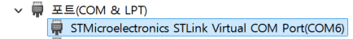

## 목표

Nucleo-64 보드(STM32L0)에서 UART로 PC와 문자열을 주고받는다.
별도의 USB-Serial 컨버터 없이 **보드에 달린 ST-LINK의 Virtual COM Port**를 사용한다.

## ST-LINK Virtual COM Port

Nucleo 보드를 USB로 연결하면 장치 관리자에 COM 포트가 하나 잡힌다.



- ST-LINK 디버거 칩이 USB ↔ UART 변환까지 해 준다.
- Nucleo-64 보드에서 이 포트는 MCU의 **USART2 (PA2 = TX, PA3 = RX)** 에 연결되어 있다. (보드 매뉴얼 UM1724의 USART communication 항목)
- 그래서 코드에서는 USART2만 설정하면 되고, PC에서는 위의 COM 번호로 터미널(Tera Term, PuTTY 등)을 열면 된다.

## 설정 (CubeMX)

| 항목 | 값 |
| --- | --- |
| Mode | Asynchronous |
| Baud Rate | 115200 bps |
| Word Length | 8 bit |
| Parity | None |
| Stop Bits | 1 |
| 핀 | PA2 (USART2_TX), PA3 (USART2_RX) |
| NVIC | USART2 global interrupt 활성화 (수신 인터럽트용) |

PC 터미널도 **115200 / 8N1**로 똑같이 맞춰야 한다. UART는 비동기 통신이라 클럭선이 없고, 양쪽이 약속한 속도로만 비트를 해석하기 때문이다.

## 1. 송신 : Polling

```c
#include <string.h>

extern UART_HandleTypeDef huart2;

int main(void)
{
    HAL_Init();
    SystemClock_Config();
    MX_GPIO_Init();
    MX_USART2_UART_Init();

    char msg[] = "Hello STM32\r\n";

    while (1)
    {
        HAL_UART_Transmit(&huart2, (uint8_t *)msg, strlen(msg), 100);
        HAL_Delay(1000);
    }
}
```

- `HAL_UART_Transmit()`는 **blocking 함수**다. 모든 바이트를 보낼 때까지(또는 timeout까지) 반환하지 않는다.
- 줄바꿈은 `\r\n`으로 보내야 대부분의 터미널에서 정상적으로 줄이 바뀐다.

## 2. printf 연결

`printf`는 결국 `_write()`(newlib)를 호출하므로, 이 함수를 UART 송신으로 바꿔 주면 된다.

```c
int _write(int file, char *ptr, int len)
{
    HAL_UART_Transmit(&huart2, (uint8_t *)ptr, len, HAL_MAX_DELAY);
    return len;
}

/* 사용 */
printf("ADC = %d\r\n", value);
```

디버깅할 때 변수 값을 확인하는 가장 간단한 방법이다.

## 3. 수신 : Interrupt (Echo)

수신을 polling으로 하면 데이터가 언제 올지 모르니 계속 기다려야 한다. `_IT` 함수로 **한 바이트 수신 인터럽트**를 걸어 두고, 받으면 다시 걸어 주는 방식으로 바꾼다.

```c
uint8_t rx;

int main(void)
{
    /* ... 초기화 ... */
    HAL_UART_Receive_IT(&huart2, &rx, 1);   // 수신 대기 등록

    while (1)
    {
        /* 메인 루프는 다른 일을 할 수 있다 */
    }
}

/* 1바이트 수신 완료 시 HAL이 호출하는 콜백 */
void HAL_UART_RxCpltCallback(UART_HandleTypeDef *huart)
{
    if (huart->Instance == USART2)
    {
        HAL_UART_Transmit(&huart2, &rx, 1, 10);  // 받은 문자 되돌려 보내기
        if (rx == '1')
            HAL_GPIO_WritePin(GPIOA, GPIO_PIN_5, GPIO_PIN_SET);    // LD2 ON
        else if (rx == '0')
            HAL_GPIO_WritePin(GPIOA, GPIO_PIN_5, GPIO_PIN_RESET);  // LD2 OFF

        HAL_UART_Receive_IT(&huart2, &rx, 1);    // 다음 수신 다시 등록
    }
}
```

- 실제 인터럽트 진입점은 `USART2_IRQHandler()` → `HAL_UART_IRQHandler()`이고, HAL이 상황에 맞는 콜백을 불러 준다.
- 콜백은 **인터럽트 문맥**에서 실행되므로 짧게 끝내야 한다. 여기서는 확인용으로 바로 송신했지만, 길어지면 플래그만 세우고 처리는 메인 루프에서 하는 편이 좋다.
- 터미널에서 `1`/`0`을 입력하면 보드의 LD2(PA5)가 켜지고 꺼진다.

## 정리

| 방식 | 함수 | 특징 |
| --- | --- | --- |
| Polling | `HAL_UART_Transmit/Receive` | 단순하지만 CPU가 기다리는 동안 다른 일을 못 함 |
| Interrupt | `HAL_UART_Transmit_IT/Receive_IT` | 바이트 단위로 인터럽트, 메인 루프와 병행 가능 |
| DMA | `HAL_UART_Transmit_DMA/Receive_DMA` | 대량 데이터를 CPU 개입 없이 전송 |

아두이노의 `Serial.begin(9600)`이 해 주던 일을 레지스터/HAL 수준에서 직접 해 보면서, UART가 **보오레이트 약속 + 시작/정지 비트로 동기화하는 비동기 통신**이라는 점을 다시 확인했다.
