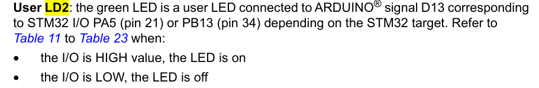
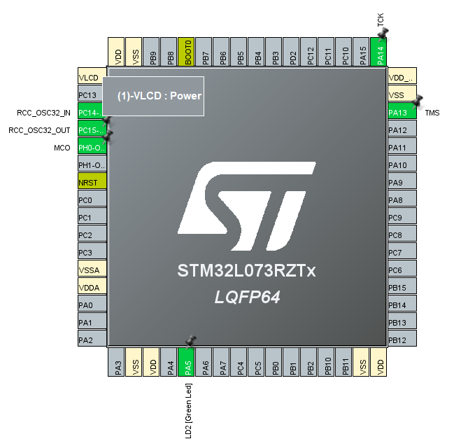

## STM32 Nucleo datasheet만 이용해서 내부 LED2번과 외부 LED를 연결해서 toggle해보자.

HAL 함수 없이, **보드 매뉴얼과 레퍼런스 매뉴얼만 보고 레지스터를 직접 설정**하는 것이 목표다.

um1724-stm32-nucleo64-boards-mb1136-stmicroelectronics datasheet을 활용하자.

### LD2번의 green LED를 제어하자.


먼저 Nucleo 보드의 LD2의 포트와 핀을 확인하자.



STM32 I/O PA5 (pin 21) or PB13 (pin 34)



기본 세팅이 되어 있다. (보드의 솔더 브리지 설정에 따라 LD2는 기본적으로 PA5에 연결된다.)


PA5번은 GPIOA port의 pin 5번이다.

## 필요한 레지스터 찾기

[MCU Bring-up 글](/2025-02-24-STM32/)에서 메모리 맵으로 찾은 주소를 그대로 쓴다.

| 단계 | 레지스터 | 주소 | 설정 |
| --- | --- | --- | --- |
| 1. 클럭 켜기 | `RCC_IOPENR` | `0x4002_1000 + 0x2C` | bit0 `IOPAEN = 1` (GPIOA 클럭 활성화) |
| 2. 출력 모드 | `GPIOA_MODER` | `0x5000_0000 + 0x00` | pin5 필드(bit 11:10) = `01` (General purpose output) |
| 3. 출력 값 | `GPIOA_ODR` | `0x5000_0000 + 0x14` | bit5 = 1이면 High (LED ON) |
| (또는) | `GPIOA_BSRR` | `0x5000_0000 + 0x18` | bit5 = Set, bit21 = Reset (원자적 변경) |

- **클럭을 먼저 켜야 한다.** STM32는 전력을 아끼기 위해 리셋 후 대부분의 주변장치 클럭이 꺼져 있다. 클럭 없이 GPIO 레지스터에 쓰면 아무 일도 일어나지 않는다. 처음에 가장 많이 하는 실수다.
- STM32L0의 MODER 리셋 값은 대부분의 핀이 `11`(Analog mode)이라서, **해당 2비트를 먼저 지운 뒤** `01`을 써야 한다.

## 코드

```c
#include <stdint.h>

#define RCC_BASE      0x40021000UL
#define GPIOA_BASE    0x50000000UL

#define RCC_IOPENR    (*(volatile uint32_t *)(RCC_BASE + 0x2C))
#define GPIOA_MODER   (*(volatile uint32_t *)(GPIOA_BASE + 0x00))
#define GPIOA_ODR     (*(volatile uint32_t *)(GPIOA_BASE + 0x14))

#define LED_PIN       5

static void delay(volatile uint32_t n)
{
    while (n--) ;
}

int main(void)
{
    RCC_IOPENR |= (1U << 0);                    /* 1. GPIOA 클럭 ON */

    GPIOA_MODER &= ~(0x3U << (LED_PIN * 2));    /* 2. pin5 모드 비트 지우기 */
    GPIOA_MODER |=  (0x1U << (LED_PIN * 2));    /*    General purpose output */

    while (1)
    {
        GPIOA_ODR ^= (1U << LED_PIN);           /* 3. 토글 */
        delay(200000);
    }
}
```

- 레지스터 주소를 `volatile` 포인터로 감싸야 컴파일러가 접근을 최적화로 없애지 않는다.
- `ODR ^=`는 읽고-수정하고-쓰는(Read-Modify-Write) 동작이라, 인터럽트에서도 같은 포트를 건드리면 값이 꼬일 수 있다. 이럴 때는 `BSRR`에 쓰는 것이 안전하다.

## 외부 LED 연결

외부 LED도 방법은 같다.

1. 보드 매뉴얼의 핀 배치도(Arduino/Morpho 커넥터)에서 **사용하지 않는 GPIO 핀**을 고른다.
2. 핀 → 저항(330Ω 정도) → LED 애노드, LED 캐소드 → GND로 연결한다. 저항이 없으면 LED와 핀에 과전류가 흐른다.
3. 위 코드에서 해당 포트의 클럭을 켜고(`IOPENR`의 해당 비트), 포트와 핀 번호만 바꿔 MODER/ODR을 설정한다.

## 정리

HAL의 `HAL_GPIO_TogglePin()` 한 줄 뒤에는 **클럭 활성화 → 모드 설정 → 출력 레지스터 쓰기**가 숨어 있다. 데이터시트만으로 이 과정을 한 번 해 보고 나니, CubeMX가 생성한 `MX_GPIO_Init()` 코드가 무엇을 하는지 읽을 수 있게 되었다.
