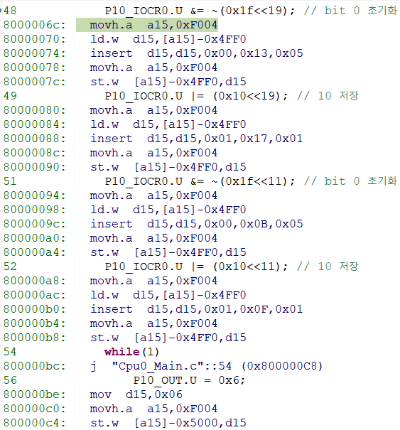
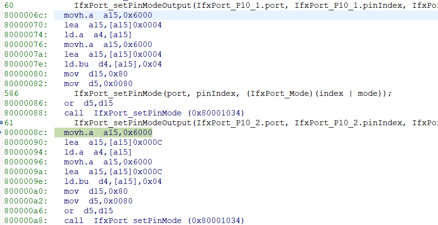
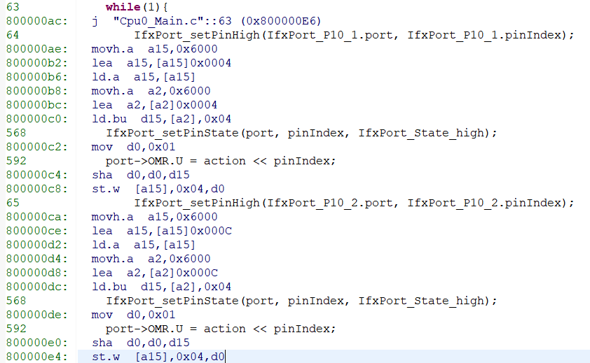

## 코드 프로파일링
성능 분석은 프로그램의 시간 복잡도 및 공간, 특정 명령어 이용, 함수 호출 주기와 빈도 등을 측정하는 동적 프로그램 분석의 한 형태.
``` c
    P10_IOCR0.U &= ~(0x1f<<19); // bit 0 초기화
    P10_IOCR0.U |= (0x10<<19); //
        

    while(1)
    {
        P10_OUT.U = 0x1<<2;
    }
```

``` assembly
48            P10_IOCR0.U &= ~(0x1f<<19); // bit 0 초기화
8000006c:   movh.a  a15,0xF004
80000070:   ld.w  d15,[a15]-0x4FF0
80000074:   insert  d15,d15,0x00,0x13,0x05
80000078:   movh.a  a15,0xF004
8000007c:   st.w  [a15]-0x4FF0,d15
49            P10_IOCR0.U |= (0x10<<19); //
80000080:   movh.a  a15,0xF004
80000084:   ld.w  d15,[a15]-0x4FF0
80000088:   insert  d15,d15,0x01,0x17,0x01
8000008c:   movh.a  a15,0xF004
   st.w  [a15]-0x4FF0,d15
```

- Reg 직접 제어

instrction 6C~C4

- Ifx 함수 제어


instrction 6C~E4

Disassembly의 차이가 32만큼 차이가 난다. (0xE4 - 0xC4 = 0x20, 즉 **32바이트의 명령어가 더 필요**하다.)

같은 동작인데 차이가 나는 이유는 다음과 같다.

- Ifx 함수(iLLD)는 **범용성**을 위해 인자 검사, 포인터 계산, 함수 호출/복귀(call/ret) 과정이 들어간다.
- 레지스터 직접 제어는 주소와 비트 위치가 컴파일 시점에 고정되어 있어 `ld.w → insert → st.w` 몇 줄로 끝난다.

그렇다고 처음부터 레지스터만으로 짜는 것은 가독성과 이식성이 떨어진다. 그래서 순서는 다음이 맞다.

1. 함수를 사용해서 코드를 짠다.
2. 프로파일링으로 **실제로 시간이 많이 걸리는 부분(Hot spot)** 을 찾는다.
3. 이후 최적화할 때, 그 부분만 함수를 레지스터를 직접 접근하는 방향으로 수정한다.

> "추측하지 말고 측정하라." 최적화는 항상 측정 결과를 근거로 해야 한다.

### 실행 시간 측정 방법

| 방법 | 설명 |
| --- | --- |
| Disassembly 비교 | 명령어 수/크기로 대략적인 비용 비교 (위의 방법) |
| GPIO 토글 + 오실로스코프 | 측정 구간 앞뒤로 핀을 토글해서 펄스 폭 측정, 가장 확실함 |
| 타이머 카운터 | 시작/끝에서 STM 같은 시스템 타이머 값을 읽어 차이 계산 |
| 디버거 Trace/Profiler | 함수별 호출 횟수와 실행 시간 통계 |

---

## 컴파일러 최적화
컴파일러 개발자는 최적화 기법 중 **최소한의 노력으로 최대한의 효과**를 낼 수 있는 가장 효율적인 방법을 골라서 컴파일러 최적화에 적용해야한다.

최적화는 **적용 범위**에 따라 나눌 수 있다.

### 1. 핍홀 최적화 (Peephole)

생성된 명령어를 작은 창(peephole)으로 훑으면서 비효율적인 패턴을 바꾼다.

- 불필요한 Load/Store 제거 : 방금 저장한 값을 다시 읽는 명령 삭제
- 강도 감소(Strength Reduction) : `x * 8` → `x << 3`
- 대수적 단순화 : `x + 0`, `x * 1` 제거

### 2. 지역 최적화 (Local)

분기가 없는 하나의 기본 블록(Basic Block) 안에서 수행한다.

- 상수 폴딩(Constant Folding) : `int a = 60 * 60 * 24;` → `86400`
- 공통 부분식 제거(CSE) : 같은 계산 `(a + b)`가 반복되면 한 번만 계산
- 복사 전파(Copy Propagation) : `b = a; c = b + 1;` → `c = a + 1;`

### 3. 전역 최적화 (Global)

함수 전체의 제어 흐름 그래프를 보고 수행한다.

- 죽은 코드 제거(Dead Code Elimination) : 결과가 쓰이지 않는 계산, 도달할 수 없는 코드 삭제
- 레지스터 할당 : 자주 쓰는 변수를 메모리 대신 레지스터에 유지

### 4. 루프 최적화 (Loop)

실행 시간 대부분은 루프에서 쓰이므로 효과가 가장 크다.

- 루프 불변 코드 이동 : 루프 안에서 값이 변하지 않는 계산을 밖으로 이동
- 루프 펼치기(Unrolling) : 반복 횟수를 줄여 분기 비용 감소 (대신 코드 크기 증가)
- 귀납 변수 강도 감소 : 매번 `i * 4`를 곱하는 대신 포인터를 4씩 증가

### 5. 프로시저 간 최적화 (Inter-procedural)

함수 경계를 넘어서 수행한다.

- 인라이닝(Inlining) : 작은 함수의 호출을 본문으로 대체해 call/ret 비용 제거
  - 위의 Ifx 함수 vs 레지스터 직접 제어 차이를 컴파일러가 자동으로 줄여 주는 방법이기도 하다.
- 링크 시간 최적화(LTO) : 여러 파일에 걸쳐 쓰이지 않는 함수 제거, 인라이닝

### 임베디드에서 주의할 점

컴파일러는 "관찰 가능한 동작이 같다면" 코드를 마음대로 바꾼다. 그래서 하드웨어를 다룰 때 문제가 생긴다.

```c
/* 최적화 시 지연 루프가 통째로 사라질 수 있다 */
for (int i = 0; i < 1000000; i++);

/* 레지스터 값이 바뀌는 것을 컴파일러가 모르면, 한 번만 읽고 재사용한다 */
while (STATUS_REG & BUSY);
```

- 하드웨어 레지스터, ISR과 공유하는 변수에는 **`volatile`** 을 붙여 매번 메모리에서 읽고 쓰게 해야 한다.
- 최적화 레벨(-O0, -O2, -Os)을 바꾸면 타이밍이 달라지므로, 소프트웨어 지연 대신 **타이머**로 시간을 재야 한다.
- 디버깅이 끝난 릴리스 빌드는 보통 속도(-O2) 또는 크기(-Os) 최적화를 사용한다. Flash가 작은 MCU에서는 -Os가 자주 쓰인다.
