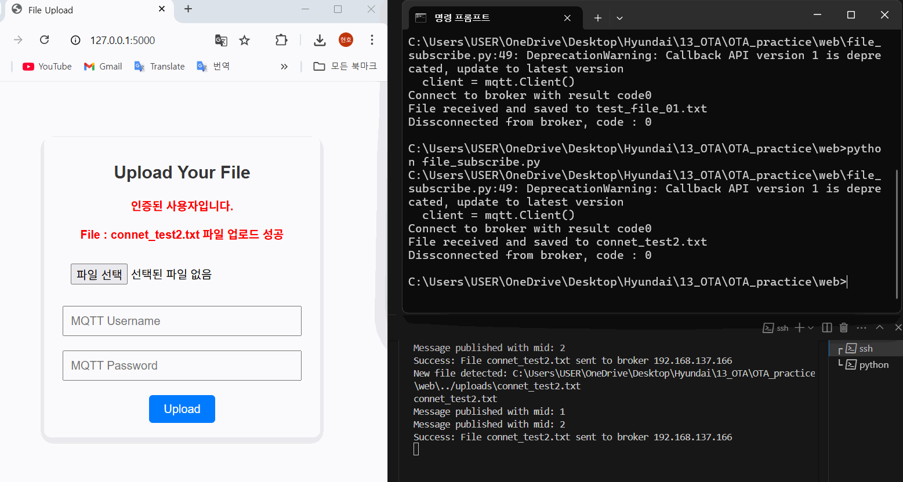

## OTA (Over-the-Air) 업데이트란?

OTA 업데이트는 무선 네트워크를 통해 소프트웨어를 원격으로 업데이트하는 기술로, 현재 많은 OEM들이 모빌리티 시스템에 적용하기 위해 노력 중이다.
예전에는 차량 소프트웨어를 고치려면 서비스센터에 가서 진단기로 ECU를 다시 써야 했지만, OTA는 차량이 서버에서 직접 업데이트를 받아 설치한다.

OTA 기술은 **SOTA**와 **FOTA**로 나뉜다.

| 구분 | SOTA (Software OTA) | FOTA (Firmware OTA) |
| --- | --- | --- |
| 대상 | 인포테인먼트, 내비게이션 지도, 앱 | 제어기(ECU) 펌웨어 (파워트레인, 섀시, ADAS 등) |
| 특징 | 리눅스/안드로이드 기반, 비교적 자주 업데이트 | 차량 동작에 직접 영향, 안전·보안 요구가 매우 높음 |

SDV(Software Defined Vehicle)에서는 FOTA로 **출고 후에도 차량 기능이 추가되고 성능이 개선**된다는 점이 핵심이다.

### 주요 특징

1. **편리성** : 사용자는 서비스센터 방문 없이 업데이트를 받을 수 있다.
2. **효율성** : 제조사는 리콜 비용을 줄이고 빠르게 소프트웨어를 배포하고 문제를 해결할 수 있다.
3. **보안성** : 최신 보안 패치를 신속히 적용할 수 있다.

### 차량 OTA의 흐름

```text
OTA 서버 ──(LTE/5G, TLS)──▶ 텔레매틱스 유닛(TCU) ──▶ OTA Master (게이트웨이/중앙 제어기)
                                                        │  패키지 검증 (서명, 무결성)
                                                        │  설치 조건 확인 (정차, 배터리 잔량)
                                                        ▼
                                              각 ECU에 배포 (Ethernet/DoIP, CAN)
                                                        │
                                              설치 → 검증 → 실패 시 롤백
```

- **서명 검증** : 위조된 소프트웨어가 설치되지 않도록 제조사 서명을 확인한다.
- **A/B 파티션** : 새 이미지를 비어 있는 B 영역에 쓰고, 검증이 끝나면 B로 부팅한다. 실패하면 A로 되돌린다(롤백). 업데이트 중 전원이 끊겨도 차량이 멈추지 않게 한다.
- **차분(Delta) 업데이트** : 전체 이미지 대신 바뀐 부분만 보내 통신량과 시간을 줄인다.
- 법규로는 **UN R156 (SUMS)** 이 소프트웨어 업데이트 관리 체계를 요구한다. ([자동차 보안 기술](/2025-03-13-Automative_Security/))

---

### OTA 업데이트의 활용 사례

- **자동차** : 인포테인먼트, 내비게이션 지도, 제어기(배터리 관리, 주행 보조 등) 소프트웨어 업데이트
- **스마트폰** : 운영 체제 및 앱의 최신 버전 배포
- **IoT 기기** : 스마트 홈 디바이스의 기능 개선 및 버그 수정

---

## 실습 : MQTT 기반 파일 배포

OTA의 핵심인 "서버에 올린 파일을 원격 장치가 받아 저장한다"를 MQTT로 단순화해서 구현했다.



### 구조

```text
[웹 업로드 페이지]  ──파일 저장──▶  uploads/ 폴더
 (Flask, :5000)                         │ 새 파일 감지
 MQTT 사용자 인증                        ▼
                                 [Publisher] ──publish──▶ [MQTT Broker] ──▶ [Subscriber]
                                                        (192.168.137.166)    파일 수신 후 저장
```

1. **업로드** : 웹 페이지에서 MQTT 계정(Username/Password)으로 인증한 사용자만 파일을 올릴 수 있다. 화면의 "인증된 사용자입니다", "파일 업로드 성공"이 이 단계다.
2. **감지와 발행** : 업로드 폴더를 감시하던 Publisher가 새 파일(`connet_test2.txt`)을 감지하면 브로커로 발행한다. (로그의 `Message published with mid: 1, 2`, `Success: File ... sent to broker`)
3. **수신** : 해당 토픽을 구독하던 `file_subscribe.py`가 브로커에 접속(`result code 0` = 성공)해서 파일을 받아 같은 이름으로 저장한다.

### MQTT를 쓴 이유

| 특징 | 설명 |
| --- | --- |
| Publish/Subscribe | 서버가 장치 주소를 몰라도 **토픽**으로 배포 가능. 장치가 늘어나도 서버 코드는 그대로 |
| 경량 | 헤더가 작아 저사양 장치, 불안정한 무선망에 적합 |
| QoS | 0(최대 1회), 1(최소 1회), 2(정확히 1회) 전달 보장 수준 선택 |
| 인증 | 브로커에서 사용자/비밀번호, TLS 인증서로 접근 제어 |

### 실제 차량 OTA와 비교해서 부족한 점

- **무결성/서명 검증이 없다.** 받은 파일이 위조되지 않았는지 확인하는 단계(해시, 전자서명)가 필요하다.
- **전송 구간 암호화(TLS)** 가 적용되지 않았다.
- 큰 파일을 한 메시지로 보내면 브로커와 네트워크에 부담이 크다. 실제로는 **청크 단위 분할 전송과 재개(Resume)** 가 필요하다.
- 설치 후 **검증과 롤백** 과정이 없다.

실습은 단순한 파일 전달이었지만, 이 부족한 부분들이 바로 차량 OTA에서 보안과 안전을 위해 추가되는 기능이라는 것을 정리할 수 있었다.

---

### 결론

OTA 업데이트는 SDV의 필수 요소로 자리 잡았다. 사용자 경험을 개선하고, 차량의 수명 동안 기능을 확장하며, 보안을 강화할 수 있다. 대신 잘못된 업데이트 하나가 수많은 차량에 동시에 영향을 줄 수 있으므로, **서명 검증, 안전한 설치, 롤백, 보안 관리 체계**가 함께 갖춰져야 한다.
